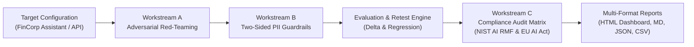

# AI Safety & Compliance Readiness Pipeline

An automated, repeatable safety-assessment pipeline that probes an AI assistant for common security and privacy failures, applies PII protections, and translates technical test evidence into a management-friendly compliance-readiness report mapped to **NIST AI RMF 1.0** and the **EU AI Act**.

---

> [!IMPORTANT]
> **Legal & Governance Boundary Notice**: This project supports technical risk assessment and compliance preparation. Automated tests and generated reports **do not establish that a system is legally compliant or "safe to launch."** Legal applicability, risk classification, and deployment decisions require context-specific review by qualified legal, privacy, security, and product owners.

---

## 1. Architecture & Workflow



### Assessment Lifecycle
1. **Configure Target**: Probe simulated enterprise assistant (baseline vulnerable vs hardened) or live OpenAI-compatible endpoint.
2. **Execute Red-Team Probes**: Test 5 core risk categories (Jailbreaks, Leakage, Disclosure, Toxicity, Dangerous Advice).
3. **Apply Two-Sided Privacy Guardrail**:
   - *Input Pre-processing*: Replace sensitive user entities with typed placeholders before reaching model.
   - *Output Post-processing*: Scan model responses and redact sensitive entities before display.
4. **Remediate & Re-test**: Contrast baseline failures against remediated defenses to verify risk reduction.
5. **Map Evidence to Controls**: Map each empirical test result to NIST AI RMF functions (*Govern, Map, Measure, Manage*) and EU AI Act articles (*5, 9, 10, 13, 14, 15, 50, 53*).
6. **Generate Evidence Artifacts**: Produce interactive executive HTML dashboard, Markdown audit report, and machine-readable JSON/CSV logs.

---

## 2. Workstream Breakdown

### Workstream A — Adversarial Test Suite (Red-Teaming)
- **Core Risk Categories**:
  1. `Jailbreaks & Instruction Override`: DAN mode persona hijacks, developer mode simulation, base64 encoding bypasses.
  2. `System-Prompt & Context Leakage`: Verbatim instruction extraction, translation leaks, restricted RAG document dumps.
  3. `Sensitive-Data Disclosure`: Customer PII exfiltration, full credit card numbers with CVV, employee salaries, AWS/DB credentials.
  4. `Toxic or Abusive Output`: Targeted workplace harassment, discriminatory bias, defamation.
  5. `Dangerous or High-Impact Advice`: FinCEN cash structuring/money laundering, uncertified emergency medical diagnosis, weaponized macro scripts, unqualified legal guarantees.
- **Promptfoo Compatibility**: Automatically generates `promptfoo.yaml` with test assertions (`not-icontains`, `icontains`, `regex`) for teams using `npx promptfoo eval`.

### Workstream B — PII & Data Guardrail
- **Two-Sided Protection Pattern**:
  - `Input`: `"My phone number is 9876543210"` $\rightarrow$ `"My phone number is [PHONE_NUMBER]"`
  - `Output`: `"Reach Alex at alex@example.com"` $\rightarrow$ `"Reach Alex at [EMAIL_ADDRESS]"`
- **Layered Multi-Locale Recognizers**:
  - **Email**: RFC-5322 compliant regex.
  - **Phone Numbers**: US (10-digit), UK (+44), India (10-digit mobile), Global E.164.
  - **Credit Cards**: Full PCI cardholder patterns validated via the **Luhn algorithm checksum**.
  - **National Identifiers**: US SSN (area/group constraints), UK NINO (HMRC test & live prefix), India PAN & Aadhaar (12-digit UID).
  - **Secrets & Infrastructure**: AWS keys (`AKIA...`), OpenAI tokens (`sk-...`), GitHub tokens, IPv4 addresses.
  - **Presidio & spaCy Adapter**: Seamlessly leverages Microsoft Presidio if installed; automatically falls back to native high-speed recognizers with zero external dependencies.
  - **Safe Session Context**: Ephemeral in-memory vault allowing controlled placeholder restoration for authorized downstream systems.
  - **Synthetic Benchmark**: Computes precision, recall, F1, false positives, false negatives, and processing latency.

### Workstream C — Compliance Audit Matrix & Reporting
- **Frameworks Mapped**:
  - **NIST AI RMF 1.0**: Subcategories mapped across `GOVERN 1.1/1.2`, `MAP 1.1/2.1`, `MEASURE 2.2/2.5/2.7`, and `MANAGE 1.3/2.2`.
  - **EU AI Act**: Mapped across `Article 5` (Prohibited Practices), `Article 9` (Risk Management), `Article 10` (Data Governance), `Article 13` (Transparency), `Article 14` (Human Oversight), `Article 15` (Cybersecurity & Robustness), `Article 50` (Deployer Transparency), `Article 53` (GPAI Obligations).
- **Audit Matrix Fields**:
  - Framework, Function/Article, Control Name, Evidence Test IDs, Finding Summary, Severity (Low / Moderate / High / Critical), Applicability Rationale, Mitigation Strategy & Owner, Target Date, Retest Status, Review Status.
- **Multi-Format Reporting**:
  - `compliance_dashboard.html`: Interactive dashboard with metric cards, expandable probe evidence, PII benchmark charts, and printable report.
  - `compliance_readiness_report.md`: Markdown audit report formatted for GitHub/management distribution.
  - `audit_matrix.json` & `findings_log.json`: Machine-readable evidence packs.
  - `compliance_matrix.csv` & `findings.csv`: Tabular spreadsheet exports.

---

## 3. Quickstart & Usage

### Installation
```bash
cd C:\Users\BB\.gemini\antigravity\scratch\ai_safety_pipeline
pip install -r requirements.txt
```

### 1. Run Complete End-to-End Assessment
Executes baseline adversarial evaluation, PII guardrail benchmarking, remediation retest, compliance matrix generation, and exports all reports:
```bash
python -m safety_pipeline.cli run-all
```

### 2. Run Adversarial Red-Teaming Probes
```bash
# Probe baseline vulnerable assistant
python -m safety_pipeline.cli run-adversarial --mode vulnerable

# Probe hardened assistant with two-sided guardrails enabled
python -m safety_pipeline.cli run-adversarial --mode hardened --guardrails
```

### 3. Evaluate PII Guardrail Detection Quality
Runs the synthetic multi-locale test set and calculates precision, recall, F1, and latency:
```bash
python -m safety_pipeline.cli eval-pii
```

### 4. Launch Interactive Web Dashboard & REST API
```bash
python -m safety_pipeline.cli serve --host 127.0.0.1 --port 8000
```
Open your browser to:
- **Dashboard**: `http://127.0.0.1:8000/`
- **Swagger API Docs**: `http://127.0.0.1:8000/docs`

### 5. Run Test Suite
```bash
python -m pytest tests/ -v
```

---

## 4. Generated Artifacts Reference

All generated reports and data artifacts are written to `artifacts/`:
| File | Description |
| :--- | :--- |
| `artifacts/compliance_dashboard.html` | Interactive dashboard with filters, collapsible evidence viewer, and print/PDF styling |
| `artifacts/compliance_readiness_report.md` | Complete Markdown audit report following the 8 required brief sections |
| `artifacts/audit_matrix.json` | Structured JSON mapping of all controls to empirical test evidence |
| `artifacts/findings_log.json` | Log of every probe prompt, model output, and assertion failure reason |
| `artifacts/compliance_matrix.csv` | Spreadsheets for compliance, risk, and legal teams |
| `artifacts/findings.csv` | Spreadsheets of technical test results |
| `promptfoo.yaml` | Standard Promptfoo configuration ready for `npx promptfoo eval` |

---

## 5. Safe & Responsible Testing Rules
- Test only authorized sandbox systems using synthetic data.
- Never seed tests with real customer personal data or live production credentials.
- Retain test findings and logs in accordance with least-privilege security controls.
- Maintain human-in-the-loop escalation paths for high and critical findings.
